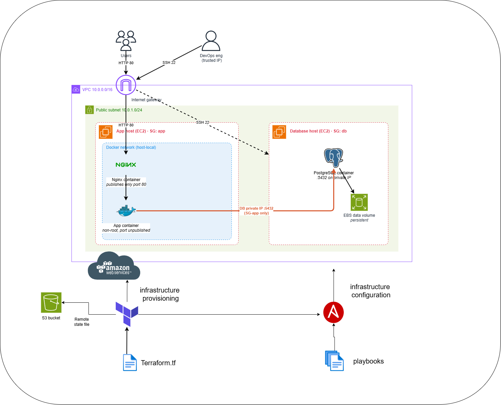
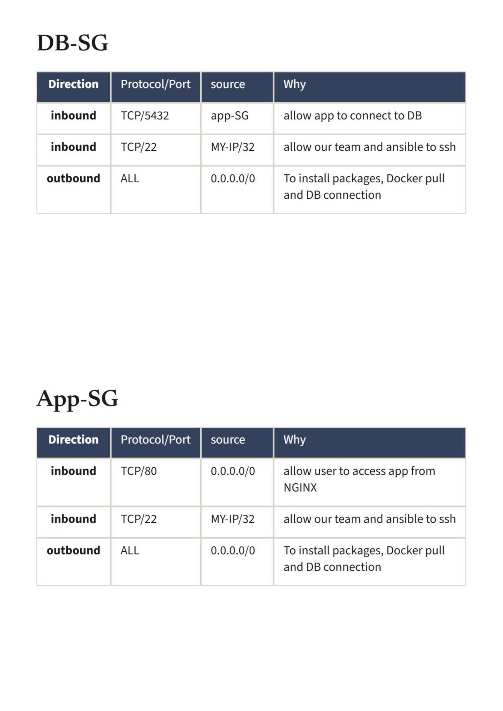

# AWS Automated Infrastructure & Application Deployment (Terraform & Ansible)

This project provisions a fully automated and production-ready AWS environment using **Terraform**, while deploying containerized workloads, an **Nginx** reverse proxy, a Node.js task management application, and a **PostgreSQL** database using **Ansible** and **Docker**.

## 🏗️ Architecture & Network Diagram

The infrastructure is provisioned on AWS within a dedicated VPC. The architecture isolates the database server from the public internet, restricting database access exclusively to the application server via private IP addresses.

### System Architecture


### Security Group Design


## 📋 Prerequisites

Before deploying the project, ensure you have the following installed and configured on your local machine:

- **AWS CLI** (v2.x) - Configured with valid credentials (`aws configure`).
- **Terraform** (v1.0.0+) - Installed for infrastructure provisioning.
- **Ansible** (v2.10+) - Installed for container orchestration and configuration management.

  ## 📂 Repository Structure

```text
.
├── ansible
│   ├── ansible.cfg
│   ├── inventory
│   │   ├── group_vars
│   │   │   └── all
│   │   │       ├── vars.yml
│   │   └── hosts.yml
│   ├── playbook
│   │   └── site.yml
│   ├── requirments.yml
│   └── roles
│       ├── app
│       │   ├── files
│       │   │   ├── Dockerfile
│       │   │   ├── nginx
│       │   │   │   └── conf.d
│       │   │   │       └── default.conf
│       │   │   ├── package.json
│       │   │   ├── package-lock.json
│       │   │   └── src
│       │   │       ├── app.js
│       │   │       ├── middleware
│       │   │       │   └── errorHandler.js
│       │   │       ├── models
│       │   │       │   └── task.js
│       │   │       └── routes
│       │   │           └── tasks.js
│       │   ├── tasks
│       │   │   └── main.yml
│       │   └── templates
│       │       └── docker-compose.yml.j2
│       ├── db
│       │   ├── defaults
│       │   │   └── main.yml
│       │   ├── tasks
│       │   │   └── main.yml
│       │   └── templates
│       │       ├── db-backup.sh.j2
│       │       ├── db-restore.sh.j2
│       │       └── docker-compose.yml.j2
│       └── docker
│           ├── handlers
│           │   └── main.yml
│           ├── tasks
│           │   └── main.yml
│           └── vars
│               └── main.yml
├── bootstrap
│   ├── main.tf
├── doc
│   ├── architecture.png
│   └── security-group.png
├── README.md
├── scripts
│   └── gen_inventory.sh
└── terraform
    ├── backend.tf
    ├── instances.tf
    ├── network.tf
    ├── output.tf
    ├── provider.tf
    ├── security_groups.tf
    └── variables.tf
```

## 🔗 Acknowledgments & Credits

The application codebase used in this project was adapted from the following repository:
- **Original App Repository:** [https://github.com/Nastry69/Docker-DevOps.git]  
*(Note: Only the application source code ).*


## 🚀 Deployment Guide

Follow these steps sequentially to provision the remote backend, configure network access, deploy the AWS infrastructure, and generate the Ansible inventory.

### : Run the Deployment Script

```bash
bash scripts/deploy.sh
```

The script runs these steps in order and stops at the first error:

1. Detects your current public IP (the only IP allowed to SSH to the servers).
2. `bootstrap/`: creates the S3 bucket that stores the Terraform remote state.
3. `terraform/`: deploys the VPC, subnet, security groups and the two EC2 instances.
4. `scripts/gen_inventory.sh`: generates the Ansible inventory from Terraform outputs, so no IP is copied by hand.
5. `ansible/`: waits for the servers, then runs `playbooks/site.yml`.


### ✅ Deployment Complete

After completing these steps, the AWS infrastructure will be provisioned, and Ansible can configure the EC2 instances.


## 🧹 Cleanup (Destroy Resources)

To avoid incurring ongoing AWS charges, destroy the created resources in reverse order.

### Step 1: Destroy Infrastructure via Terraform

Navigate to the `terraform` directory and destroy the main AWS infrastructure.

```bash
cd terraform
terraform destroy -var="key_name=your-key-pair-name" -auto-approve
```

### Step 2: Destroy the S3 Remote Backend

After destroying the main infrastructure, navigate to the `bootstrap` directory and destroy the S3 bucket used for Terraform remote state.

```bash
cd ../bootstrap
terraform destroy -auto-approve
```

> **⚠️ Warning:** Destroying the S3 remote backend will remove the remote state storage. Ensure that all resources managed by this backend have been destroyed before proceeding. Back up any state files you may need for recovery.

### ✅ Cleanup Complete

All Terraform-managed infrastructure and the remote backend should be destroyed successfully. Verify the resources in the AWS Console to ensure that no unexpected billable resources remain.


## 👨‍💻 Author

**Ahmed Gamal Abohagar**

- **LinkedIn:** [LinkedIn Profile](https://www.linkedin.com/in/ahmed-abohagar/)
- **GitHub:** [ahmedgamalabohagar](https://github.com/ahmedgamalabohagar)

